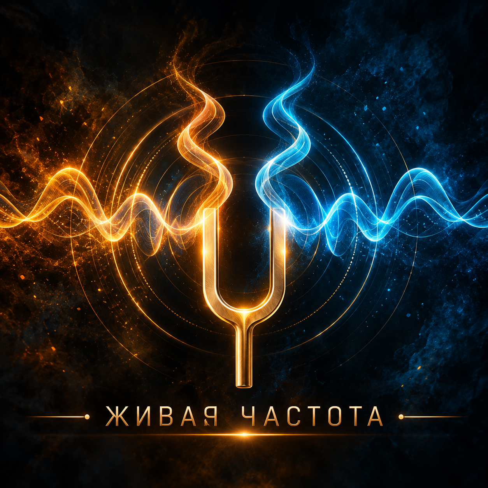

  

# Камертон

Персональная n-of-1 система, которая подбирает практику настройки желания
под одного владельца по его собственным данным.

**Нота: между тем, чего я хочу, и тем, что я делаю, нет зазора — и это видно
по результату.**

## Принцип

1. Метафора — интерфейс, наука — движок.
2. Решает ядро на числах, модель только переводит.

Система не доказывает теорию резонанса, а проверяет её на владельце. Луна,
частоты и звуковые режимы входят как переменные с низким приором, а не как
допущения.

## Устройство

| Слой | Чем является |
| --- | --- |
| Интерфейс | Telegram на long polling; Mini App с волны 2 |
| Модель | Локальная LLM и Reflex; внешняя — только на публичных данных |
| Ядро | Планировщик, бандит, слепой контекст, клапан честности |
| Хранилище | SQLite на домашнем сервере, бэкап еженедельно |

Язык реализации — **Metalogos**, целиком. Браузерная часть Mini App — HTML и
JavaScript. Третьего языка в проекте нет.

## Размещение

Домашний сервер Windows 10, работающий 24/7, под WSL2. Long polling вместо
вебхука: публичный адрес и открытые порты не нужны, данные физически у
владельца.

## Зависимость от языка

Блокирующая волна 30 Metalogos принята 2026-10-05: наряды №590–№596 смержены
в main (гауссово сэмплирование, спектральный контур, пер-вызовный таймаут,
DDL-replay, паритет тика и маршрута, календарная арифметика) — предпосылка
старта волны 1 выполнена. Разбор: `docs/metalogos-volna-30.md`.

Правило: волна языка открывается только когда фаза приложения упёрлась в
конкретную стену. Возможности «на будущее» не заказываются.

## Что это не

- Не продукт и не публикуется: пользователь один.
- Не генератор картинок и видео.
- Не геймификация: очков и стриков нет.
- Fosved Office не затрагивается.

## Голосовой контур

Клонирование голоса владельца снято с карты насовсем: задачу решает готовый
женский голос, биометрия не нужна.

Озвучка — локальный TTS на процессоре отдельным процессом рядом с приложением.
Медитативность задаётся темпом, а не тембром: скорость около 0,8 от обычной,
паузы между фразами 1,5–2 секунды, параметры зафиксированы в конфиге. Два-три
голоса сравниваются слепо и становятся рукой бандита, а не настройкой
интерфейса.

Распознавание голосового отклика — внешний Whisper, тоже отдельным процессом:
реальный инференс в языке стоит на аппаратном гейте. В язык под голос ничего
не заказывается.

## Документы

| Файл | Что внутри |
| --- | --- |
| `AGENTS.md` | Язык, затык, секреты, среда, инварианты, Quality OS, конвейер |
| `deploy/environment.md` | Факты среды: пути, версии, команда сборки языка |
| `docs/concept-v2.md` | Концепция, архитектура, дорожная карта |
| `docs/volna-1-issues.md` | Наряды волны 1 |
| `docs/metalogos-volna-30.md` | Наряды в язык, блокирующие волну 1 |
| `docs/worklog.md` | Append-only журнал |
| `docs/adr/0001-reward-construction.md` | ADR-0001: инвариант 3 — флаги присутствия, нормированная награда, два источника |

## Дисциплина

Слово «готово» имеет силу только после независимой проверки. Волна
закрывается только при ALL GREEN. Упёрлись — заявляем громко и
останавливаемся. Подробности в `AGENTS.md`.
